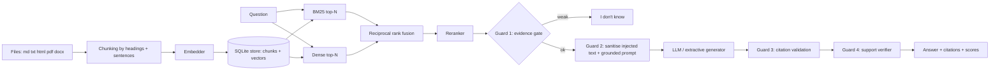

# ragkit

[](https://github.com/muneerahmedkhokhar53-wq/RAG-system-with-an-evaluation-harness/actions/workflows/ci.yml)


**Retrieval-augmented generation you can measure.** ragkit answers questions only from your own documents, cites its sources, refuses when the documents don't contain the answer, and ships with an evaluation harness that scores retrieval quality, answer correctness, grounding, safety and latency on a reproducible dataset.

- **Runs fully offline and free by default** (no API keys, no model downloads). Swap in neural embeddings, a cross-encoder reranker, local Ollama models or Claude/OpenAI through `config.yaml`.
- **Four hallucination guards** between question and answer, each covered by tests.
- **Evaluation as a first-class feature:** ablations, bootstrap confidence intervals, per-category breakdowns, optional LLM judge, and a CI quality gate that fails the build when scores regress.
- **Three interfaces:** CLI, Streamlit web UI, FastAPI REST service.

> See a real run: [`docs/sample-report/report.md`](docs/sample-report/report.md)

## Contents
[Quick start](#quick-start) · [How it works](#how-it-works) · [Configuration](#configuration) · [Using real models for free](#upgrading-to-real-models) · [Evaluation](#evaluation) · [Security](#security-and-reliability) · [Project layout](#project-layout) · [Limitations](#limitations) · [Troubleshooting](#troubleshooting)

## Quick start

Requires Python 3.10+.

```bash
git clone https://github.com/muneerahmedkhokhar53-wq/RAG-system-with-an-evaluation-harness.git && cd ragkit
python -m venv .venv
source .venv/bin/activate            # Windows PowerShell: .venv\Scripts\Activate.ps1
python -m pip install -e ".[all,dev]"

pytest -q                            # run the test suite
python -m ragkit ingest data/corpus  # index the sample documents
python -m ragkit ask "How many days of paid time off do I get?"
python -m ragkit eval --ablate       # evaluation report -> results/<timestamp>/report.html
python -m streamlit run app/streamlit_app.py   # web UI  http://localhost:8501
python -m ragkit serve                         # REST API http://127.0.0.1:8000/docs
```

Prefer `python -m pip` and `python -m streamlit` on Windows: they guarantee the packages and commands belong to the same Python. Without extras, `pip install -e .` installs only the core (numpy, PyYAML); extras are `ui`, `api`, `pdf`, `docx`, `neural`, `anthropic`, `openai`, `dev`.
If PowerShell blocks activation, run once: `Set-ExecutionPolicy -Scope CurrentUser RemoteSigned`.

**Using the UI:** *Documents* tab → upload files → click **Index uploaded files** (uploads are only staged until you do). Then ask in the *Ask* tab and open **Sources** under an answer to see the exact passages.

Docker: `docker build -t ragkit . && docker run -p 8000:8000 -e RAG_API_KEY=change-me ragkit`

## How it works



| Stage | Details |
|---|---|
| Ingestion | md/txt/rst/html/pdf/docx; size and type limits; filename sanitising; per-document atomic upsert; unchanged files are skipped |
| Chunking | splits on headings, packs sentences to a word budget with overlap; the section title is indexed with each chunk |
| Retrieval | own BM25 + dense vectors, fused by RRF (no score calibration needed), then a lexical or cross-encoder reranker |
| Guard 1 | IDF-weighted query-term coverage of the best passage; refuses before spending an LLM call |
| Guard 2 | injection-looking sentences are removed from retrieved text; prompt marks context as untrusted |
| Guard 3 | citations to non-existent passages are stripped |
| Guard 4 | answer terms and every number must appear in the context; otherwise the answer is withheld (or flagged) |

**Design trade-offs.** SQLite + exact NumPy search needs no infrastructure and is fine to ~100k chunks; swap `VectorStore` for FAISS/Qdrant/pgvector beyond that. Guard 4 is a fast heuristic, not an entailment model: it catches fabricated numbers, not subtle reasoning errors (use the LLM judge for those). The index records its embedder and refuses to open with a different one (`--rebuild` to change).

## Configuration

Everything lives in [`config.yaml`](config.yaml); any value can be overridden per command:

```bash
python -m ragkit --set retrieval.mode=bm25 --set generation.min_coverage=0.5 eval
```

Secrets come from environment variables or an untracked `.env` file (loaded automatically; copy `.env.example`). Real environment variables take precedence.

| Variable | Purpose |
|---|---|
| `ANTHROPIC_API_KEY` | only for `generation.provider: anthropic` (paid) |
| `OPENAI_API_KEY` | only for OpenAI itself (paid); not needed for local servers |
| `RAG_API_KEY` | optional password for the REST API (any random string you generate) |
| `RAG_LOG_LEVEL` | `INFO` (default) or `DEBUG` |

## Upgrading to real models

The offline defaults are a deterministic baseline: the hashing embedder matches words, not meaning, and the extractive generator copies matching sentences. For real quality, free and local:

1. Install [Ollama](https://ollama.com) (`winget install Ollama.Ollama` on Windows) **and download a model**: `ollama pull llama3.2`. (Installing Ollama alone gives you the engine, not a model.)
2. `python -m pip install sentence-transformers openai`
3. Edit `config.yaml`:
   ```yaml
   embedding:  {provider: sentence_transformers, model: BAAI/bge-small-en-v1.5}
   retrieval:  {reranker: cross_encoder}
   generation: {provider: openai, model: llama3.2, base_url: "http://localhost:11434/v1"}
   ```
4. `python -m ragkit ingest data/corpus --rebuild && python -m ragkit eval --ablate`

Hosted alternative: `generation: {provider: anthropic, model: claude-sonnet-5-5}` with `ANTHROPIC_API_KEY` set. **Re-tune `generation.min_coverage` after switching models** (see below). These back-ends are implemented but not exercised by the test suite, because they need downloads or keys.

## Evaluation

The benchmark figures below describe the bundled offline dataset and configuration only; they are not a guarantee of performance on other corpora or models. Re-run the evaluation after changing the corpus, model, retrieval settings, or thresholds.

`python -m ragkit eval [--ablate] [--dataset file.jsonl]` writes `results/<timestamp>/` containing `report.html`, `report.md`, `summary.json` (config, dataset hash, versions, seed) and `per_question.jsonl`. It exits non-zero when a threshold in `eval.thresholds` is violated, which is what the CI workflow uses.

| Metric | Meaning |
|---|---|
| Hit@k, Recall@k, Precision@k, MRR, nDCG@k | did retrieval find the gold evidence, and how high |
| Accuracy | the answer contains **all** required key facts |
| Token F1, answer relevance | secondary overlap / similarity signals |
| Faithfulness, unfaithful rate | share of the answer supported by the retrieved context |
| Citation precision / recall | cited passages that hold the evidence / evidence covered by citations |
| Abstention accuracy, hallucination rate, false-abstain rate | behaviour on unanswerable vs. answerable questions |
| Latency | retrieval, generation, total: mean, p50, p95 |
| LLM judge (optional) | correctness / faithfulness / relevance, 1-5 |

**Your own data.** Add JSONL lines to `data/eval/qa_dataset.jsonl` (or pass `--dataset`):
```json
{"id":"q1","question":"...","reference_answer":"...","answerable":true,"category":"factoid",
 "gold_sources":["file.md"],"evidence":["short verbatim sentence fragment"],"must_include":["key fact"]}
```
Relevance is judged by *evidence text inside the retrieved chunk*, so scores stay valid when you change chunking. A test checks that every evidence string exists in the corpus.

**Tuning the refusal threshold.** `generation.min_coverage` trades refusals against risk. Sweep it and watch accuracy against abstention accuracy:
```bash
for t in 0.35 0.45 0.55; do python -m ragkit --set generation.min_coverage=$t eval --no-gate; done
```

### Results on the bundled benchmark (offline config, 30 answerable + 7 unanswerable)

| Hit@4 | MRR | Accuracy | Faithfulness | Abstention accuracy | False-abstain | p95 latency |
|---|---|---|---|---|---|---|
| 0.967 | 0.967 | 0.900 | 1.000 | 85.7% (6/7) | 6.7% | ~1 ms |

## Security and reliability

Optional API-key auth with constant-time comparison; upload size/type limits and filename sanitising; secrets only from the environment; prompt-injection text stripped from retrieved passages; input length limits; LLM calls retry with exponential backoff and degrade to a safe message; a bad file never aborts a batch ingest; structured logs with request ids. **Not included** (add before exposing publicly): TLS, rate limiting, per-user document access control, PII redaction. Report vulnerabilities via [SECURITY.md](SECURITY.md).

## Project layout

```
ragkit/            core library (loaders, chunking, embeddings, store, bm25, retrieval, generation, pipeline, api, cli)
ragkit/evaluation/ dataset schema, metrics, judge, runner, reports
app/               Streamlit UI
data/corpus/       sample documents (a fictional company, so no model can answer from memory)
data/eval/         sample evaluation dataset
tests/             unit, integration, API and UI tests
docs/              sample evaluation report
.github/           CI, issue/PR templates, Dependabot
```

Extending: new file type in `loaders.py`; new embedder or LLM by subclassing `Embedder` / `LLM` and registering in `build_*`; new metric in `evaluation/metrics.py` then `runner.summarize` and `report.build_sections`.

## Limitations

- The bundled benchmark is small (32 chunks), so the four retrieval strategies tie; use a larger corpus to separate them.
- `min_coverage` was tuned on the same dataset it is scored on (in-sample). Hold out a test split before trusting it.
- Known failures, visible in the report: a paraphrase the offline embedder cannot bridge ("wireless frequency" vs "2.4 GHz Wi-Fi"), a hard negative that shares words with real passages, and a two-fact question answered only partly.
- The offline extractive generator is verbose by design and returns long blocks for tables; a real LLM writes proper sentences.
- Scanned (image-only) PDFs have no extractable text; OCR is not included.
- Tested on Python 3.12 locally; CI runs 3.10-3.12.

## Troubleshooting

| Symptom | Fix |
|---|---|
| `streamlit` is not recognized | use `python -m streamlit run app/streamlit_app.py` |
| `PDF support needs pypdf` | `python -m pip install pypdf` (use the same Python that runs the app) |
| Everything answers "I don't know" | the file was never indexed (click **Index uploaded files**), or lower `generation.min_coverage` |
| `Index was built with 'X' but config uses 'Y'` | `python -m ragkit ingest <path> --rebuild` |
| API shows 404 at `/` | the API has no home page; open `/docs` or `/health` |
| UI shows a stale index after a CLI ingest | restart Streamlit |

## License

MIT, see [LICENSE](LICENSE).
